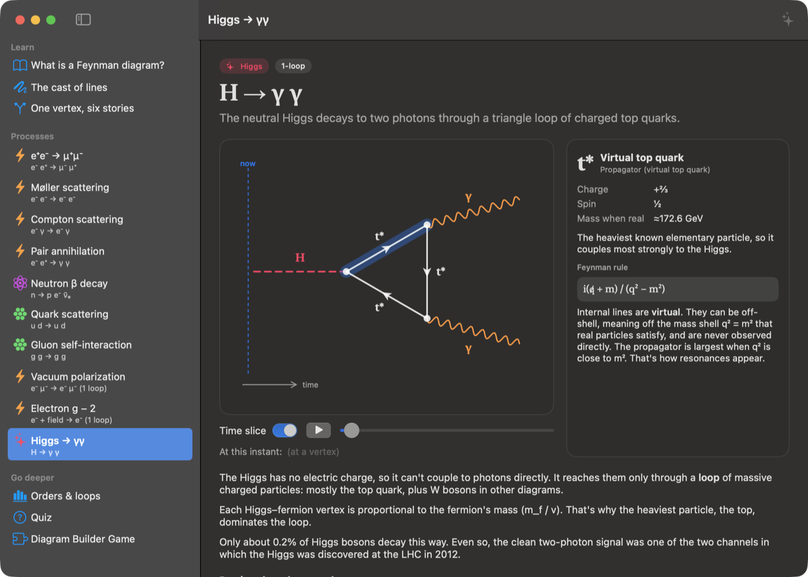
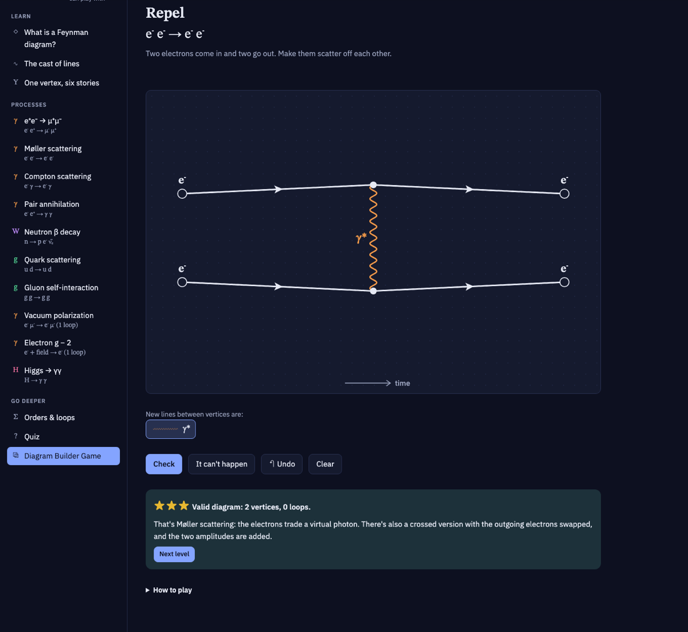
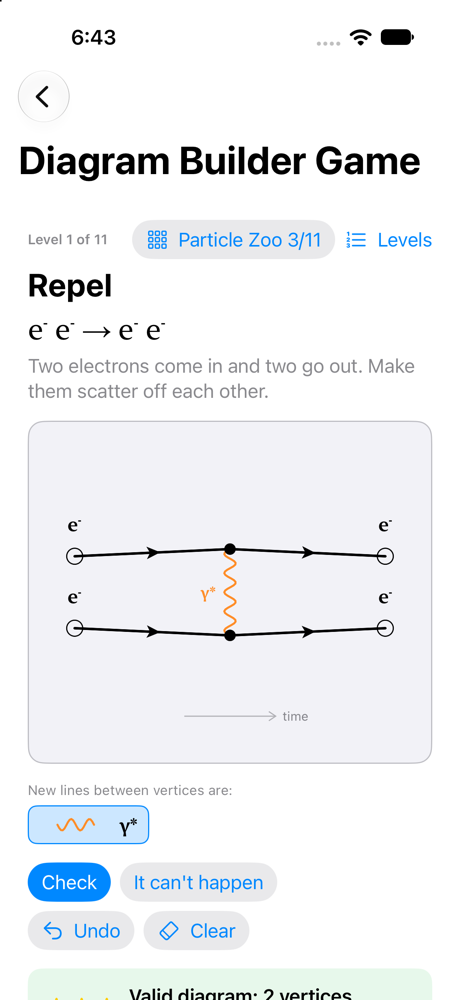

# Quarksman

Feynman diagrams you can play with. Quarksman is an interactive app for learning to read Feynman diagrams, as a native SwiftUI app for macOS, iPhone and iPad, and as a single-page web version built with d3.

**[Try the web version](https://ijt.github.io/quarksman/web/)** · **[Watch the 82-second demo](https://ijt.github.io/quarksman/docs/Quarksman-demo.mp4)**



<p>
  
  
</p>

- **Learn**: what the diagrams mean, the line styles for each particle, and a rotatable QED vertex.
- **Processes**: ten real processes (e⁺e⁻ → μ⁺μ⁻, Compton scattering, β decay, Higgs → γγ, …). Click any line or vertex to see its Feynman rule, and drag a time slice to see which particles exist at each moment.
- **Orders & loops** and a **quiz**.
- **Diagram Builder Game**: a puzzle. Build a valid Feynman diagram for each process, with the fewest vertices for three stars.
- **Ask Claude** (⌘K): questions about the page you're on, answered by Claude with the page's contents as context.
- **Find** (⌘F) on any page.

## Run on macOS

Requires macOS 14 or later and a recent Xcode for the Swift toolchain. It's built and tested with Xcode 27.

```sh
swift run
```

You can also open `Package.swift` in Xcode and press Run.

## Run on iPhone or iPad

Requires iOS 17 or later. Tested with Xcode 27 and the iOS 27 simulator.

1. Open `Quarksman.xcodeproj` in Xcode.
2. Pick the **Quarksman-iOS** scheme and a simulator or your device.
3. Press Run.

To run on your own device, select your team under **Signing & Capabilities**, and change the bundle ID (`com.issactrotts.Quarksman` in `project.yml`) if Xcode says it's taken.

If you don't have a simulator, install one from **Xcode → Settings → Components**, or run `xcodebuild -downloadPlatform iOS`.

## Run the web version

Open [ijt.github.io/quarksman/web](https://ijt.github.io/quarksman/web/), or open `web/index.html` from a checkout in a browser. It's a single file that loads d3 from a CDN and has the same lessons, processes and game as the app, with progress saved in the browser.

Ask Claude in the web version works when the page is hosted as a claude.ai artifact, where it runs on the viewer's own Claude account. Opened as a local file, it hides itself.

## Tests

```sh
swift test                          # app: game rules, line selection, diagram labels
node web/tests/game-rules.test.mjs  # web: the same game-rule scenarios
```

The game tests cover the physics rules: vertex types, fermion arrows, and charge and flavor conservation.

## Ask Claude

Ask Claude needs an [Anthropic API key](https://console.anthropic.com/).

- **macOS**: set `ANTHROPIC_API_KEY` in the environment before `swift run`, or enter a key in **Settings** (⌘,). Settings stores it in your keychain.
- **iOS**: open the Ask panel and tap the key button.

Conversations are saved per page in `~/Library/Application Support/Quarksman/conversations.json` (inside the app's container on iOS) and restored on launch.

## Project layout

- `Sources/Quarksman/`: all the app code, shared by both platforms.
- `Package.swift`: builds the macOS app with SwiftPM.
- `Tools/MakeIcon.swift`: draws the app icon. Run `swift Tools/MakeIcon.swift` to regenerate both the iOS and macOS versions.
- `project.yml`: generates `Quarksman.xcodeproj` for iOS with [XcodeGen](https://github.com/yonaskolb/XcodeGen). After adding or removing source files, run:

  ```sh
  brew install xcodegen   # once
  xcodegen
  ```

## How it was built

Quarksman was built over a couple of days in October 2026 by Issac Trotts working with [Claude Code](https://claude.com/claude-code). Issac set the direction and made the product, physics and design calls, and Claude Code wrote most of the code. Commits carry a `Co-Authored-By: Claude` trailer, and the history shows how the app took shape, one small commit at a time.

## License

MIT. See [LICENSE](LICENSE).

